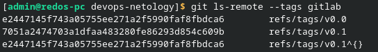
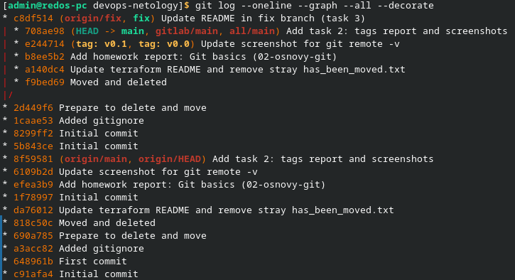

# Домашнее задание к занятию «Основы Git» - `Леонов Алексей`

---

## Задание 1 Знакомимся с GitLab и Bitbucket

### Ссылки на репозитории

- GitHub: https://github.com/ice017-git/devops-netology
- GitLab: https://gitlab.com/mycompany-group4770947/devops-netology

Вывод команды `git remote -v`:

## Задание 2. Теги

Созданы два тега на HEAD-коммите и отправлены в оба удалённых репозитория (GitHub и GitLab):

- `v0.0` — **легковесный** тег (lightweight).
- `v0.1` — **аннотированный** тег (annotated) с сообщением «Annotated tag for version 0.1».

# создание тегов
git tag v0.0
git tag -a v0.1 -m "Annotated tag for version 0.1"

Разница между тегами
Легковесный (v0.0) — просто указатель на коммит. Не хранит автора, дату и сообщение.
Аннотированный (v0.1) — полноценный объект Git: хранит автора, дату и сообщение. Рекомендуется для релизов.

Вывод git ls-remote --tags origin

## Задание 3. Ветки

### 1. Переключение на ветку main

git switch main

Ветка main связана с main репозитория на GitHub (и с gitlab/main).

### 2. Поиск коммита «Prepare to delete and move»

git log --oneline --all | grep -i "Prepare to delete"

результат:

2d449f6 Prepare to delete and move
690a785 Prepare to delete and move

### 3. Переход на найденный коммит

git checkout 2d449f6
Git перешёл в состояние detached HEAD (HEAD указывает напрямую на коммит, а не на ветку).

### 4. Создание ветки fix от этого коммита
git switch -c fix
Переключились на новую ветку «fix»

### 5. Отправка ветки fix в GitHub
[admin@redos-pc devops-netology]$ git push -u origin fix

Результат:
Total 0 (delta 0), reused 0 (delta 0), pack-reused 0 (from 0)
remote:
remote: Create a pull request for 'fix' on GitHub by visiting:
remote:      https://github.com/ice017-git/devops-netology/pull/new/fix
remote:
To https://github.com/ice017-git/devops-netology.git
 * [new branch]      fix -> fix
branch 'fix' set up to track 'origin/fix'.

### 6. Посмотрел схему коммитов на GitHub Network:
https://github.com/ice017-git/devops-netology/network

### 7.Изменил README.md на ветке fix, добавив строку «Изменение в ветке fix для задания 3.».

[admin@redos-pc devops-netology]$ echo "
Изменение в ветке fix для задания 3." >> README.md
[admin@redos-pc devops-netology]$ tail -5 README.md
# devops-netology

Репозиторий для домашних заданий по курсу DevOps.

Изменение в ветке fix для задания 3.

### 8.Закоммитил и запушил:

[admin@redos-pc devops-netology]$ git add README.md
git commit -m "Update README in fix branch (task 3)"
git push origin fix
[fix c8df514] Update README in fix branch (task 3)
 1 file changed, 2 insertions(+)
Перечисление объектов: 5, готово.
Подсчет объектов: 100% (5/5), готово.
При сжатии изменений используется до 4 потоков
Сжатие объектов: 100% (3/3), готово.
Запись объектов: 100% (3/3), 422 bytes | 422.00 KiB/s, готово.
Total 3 (delta 1), reused 0 (delta 0), pack-reused 0 (from 0)
remote: Resolving deltas: 100% (1/1), completed with 1 local object.
To https://github.com/ice017-git/devops-netology.git
   2d449f6..c8df514  fix -> fix

Результат: коммит c8df514, push 2d449f6..c8df514 fix -> fix.

Схема коммитов
Вывод git log --oneline --graph --all --decorate:

Из вывода видно:

ветка fix (c8df514) ответвляется от 2d449f6 (точка |/);
ветка main (708ae98) продолжается независимо;
символ |/ — место ответвления ветки fix от общей истории.
