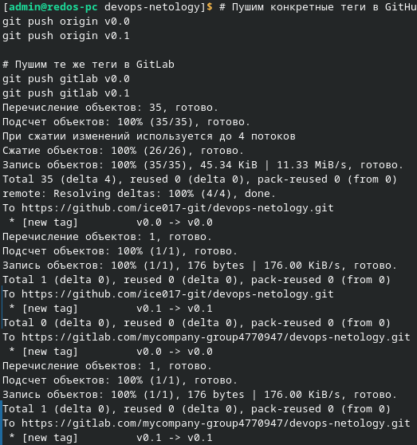

# Домашнее задание к занятию «Основы Git» - `Леонов Алексей`

---

## Задание 1 Знакомимся с GitLab и Bitbucket

### Ссылки на репозитории

- GitHub: https://github.com/ice017-git/devops-netology
- GitLab: https://gitlab.com/mycompany-group4770947/devops-netology

Вывод команды `git remote -v`:

## Задание 2. Теги

Созданы два тега на HEAD-коммите и отправлены в оба удалённых репозитория (GitHub и GitLab):

- `v0.0` — **легковесный** тег (lightweight).
- `v0.1` — **аннотированный** тег (annotated) с сообщением «Annotated tag for version 0.1».

# создание тегов
git tag v0.0
git tag -a v0.1 -m "Annotated tag for version 0.1"

Разница между тегами
Легковесный (v0.0) — просто указатель на коммит. Не хранит автора, дату и сообщение.
Аннотированный (v0.1) — полноценный объект Git: хранит автора, дату и сообщение. Рекомендуется для релизов.

Вывод git ls-remote --tags origin

