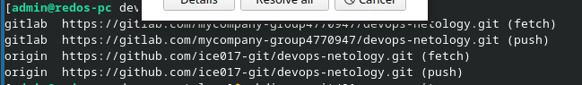

# Домашнее задание к занятию «Основы Git» - `Леонов Алексей`

---

## Задание 1 Знакомимся с GitLab и Bitbucket

### Ссылки на репозитории

- GitHub: https://github.com/ice017-git/devops-netology
- GitLab: https://gitlab.com/mycompany-group4770947/devops-netology

Вывод команды `git remote -v`:

