# Домашнее задание к занятию «Ветвления в Git» — Леонов Алексей

## Шаг 0. Подготовка

Создана папка `branching` и два файла: `merge.sh` и `rebase.sh` с первоначальным содержимым.

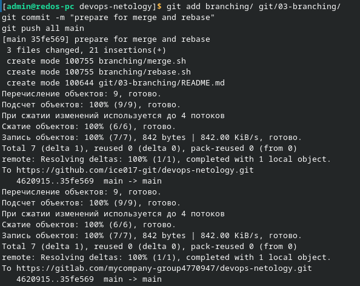

# Хеш коммита: 35fe569

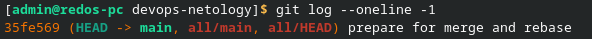

## Шаг 1. Ветка git-merge
Создана ветка git-merge от main, внесены изменения в merge.sh:

1. Замена $* на $@ (коммит 5e7bf1d — merge: @ instead *).

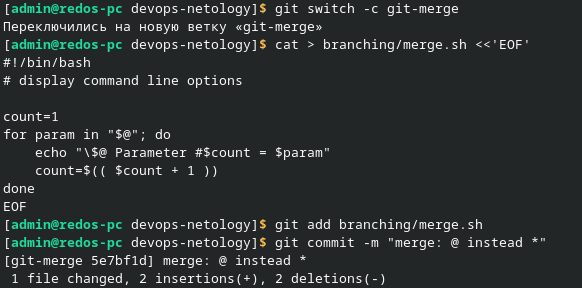

2. Замена цикла for на while с shift (коммит acc5fa6 — merge: use shift).

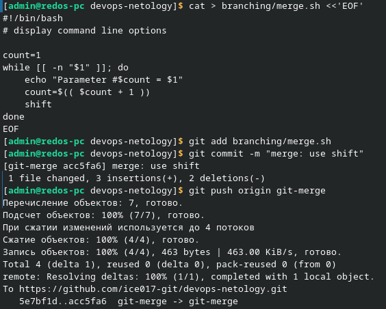

## Шаг 2. Изменение main

Пока работали над веткой, в main добавлен echo "=====" в конец rebase.sh (коммит 40e744d).

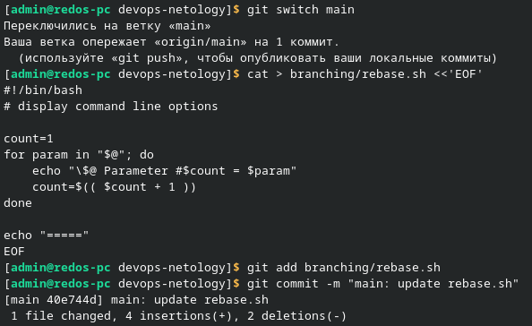

## Шаг 3. Ветка git-rebase
Создана ветка git-rebase от старого коммита 35fe569. Внесены изменения:

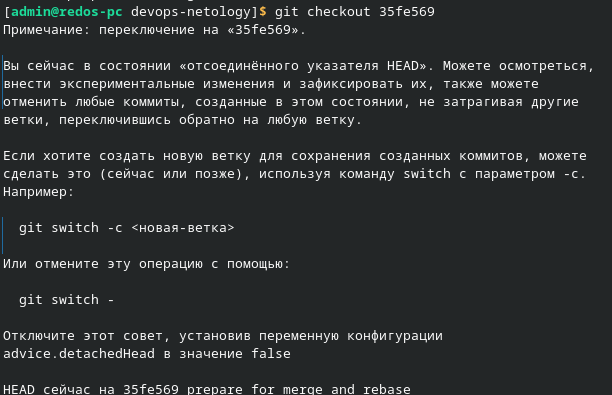

echo "Parameter: $param" (коммит 507bc09 — git-rebase 1).

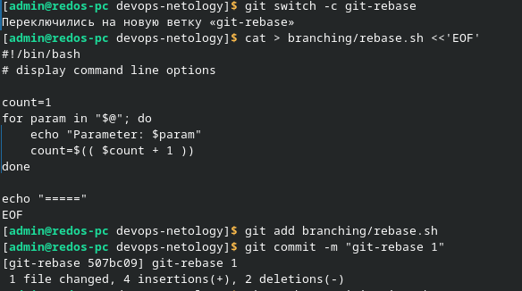

echo "Next parameter: $param" (коммит d74aee5 — git-rebase 2).

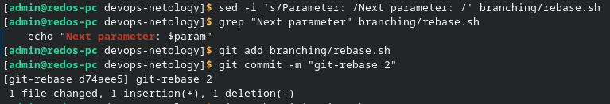

## Шаг 4. Merge ветки git-merge в main

Выполнен merge без конфликтов. Создан merge-коммит 8baa77d.
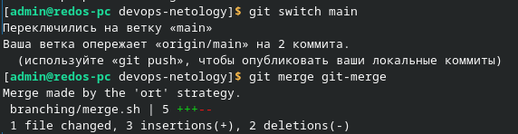

## Шаг 5. Rebase ветки git-rebase на main

Выполнен интерактивный rebase с объединением коммитов (fixup) и разрешением конфликтов в файле rebase.sh.
При первом конфликте оставлена строка echo "\$@ Parameter #$count = $param".
При втором конфликте оставлена строка echo "Next parameter: $param".
После rebase история перезаписана, выполнен force push:

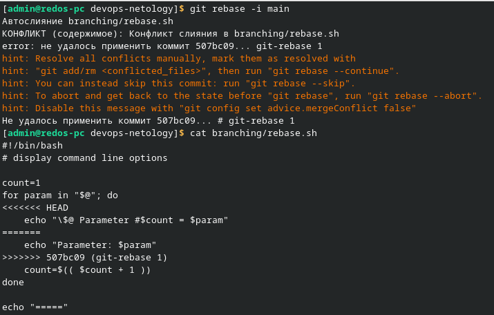

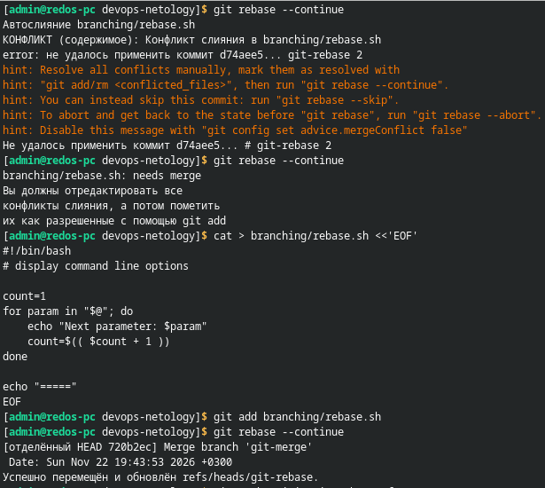

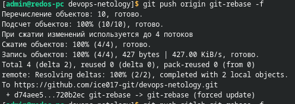

## Шаг 6. Merge ветки git-rebase в main

Выполнен merge. Из-за особенностей перезаписи сообщения коммита при rebase Git создал merge-коммит 0f5bfc5 (вместо fast-forward).

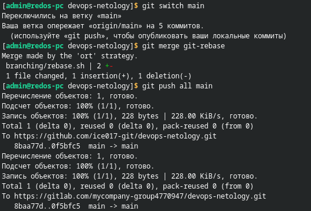

## Итоговая схема коммитов

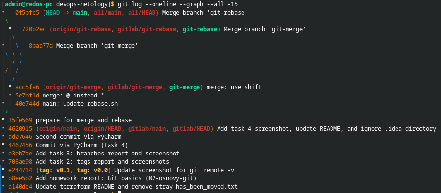

## Разница между merge и rebase

- Merge (git-merge) сохраняет историю ветвления: создаётся merge-коммит с двумя родителями, и на графе видна «развилка».

- Rebase (git-rebase) переписывает историю: коммиты ветки «переносятся» поверх main, делая историю линейной. В нашем случае из-за особенностей сообщений коммитов merge всё равно создал коммит, но суть rebase (перезапись истории и объединение коммитов через fixup) была продемонстрирована.
